<div align="center">

# 🛣️ Roadway Functional Class Enrichment for DC Utility Permits

### Which FHWA roadway class does each 2026 DC Water, PEPCO and Washington Gas work location sit on, and what is the highest class for each permit application?

A conservative, fully auditable **Python + GIS** pipeline. It downloads DDOT TOPS permit locations, filters the three
utilities, matches every location to an official DDOT roadway through the Linear Referencing System (LRS), and reports the
**highest FHWA functional class per application**. It never guesses: uncertain matches are kept and flagged for review.


**Amir Moayyedi** · DDOT CS-12 Data Scientist assessment (Python)

</div>

---

## 🗺️ The result on a map

<p align="center">
  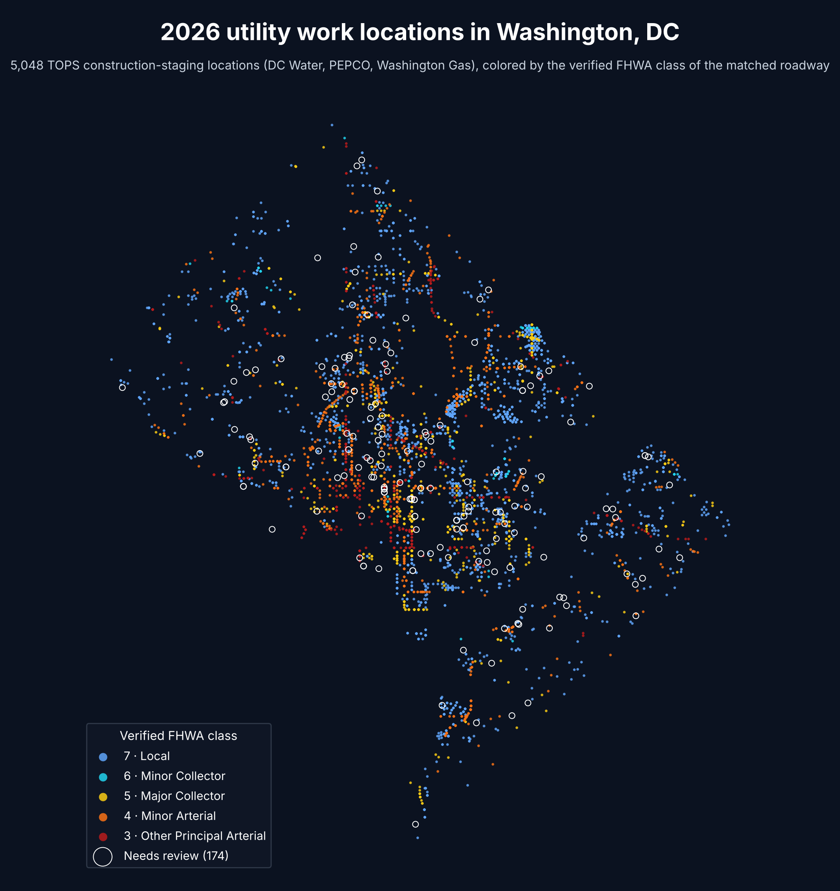
</p>

<sub>Each dot is one TOPS work location, plotted from its longitude and latitude and colored by the **verified** FHWA class
of the roadway it was matched to. White rings mark the 174 locations that are kept in the deliverable but still need review.
Arterials (red and orange) trace the city's main corridors; most work sits on local streets (blue).</sub>

---

## 🎞️ Project in 6 slides

<p align="center">
  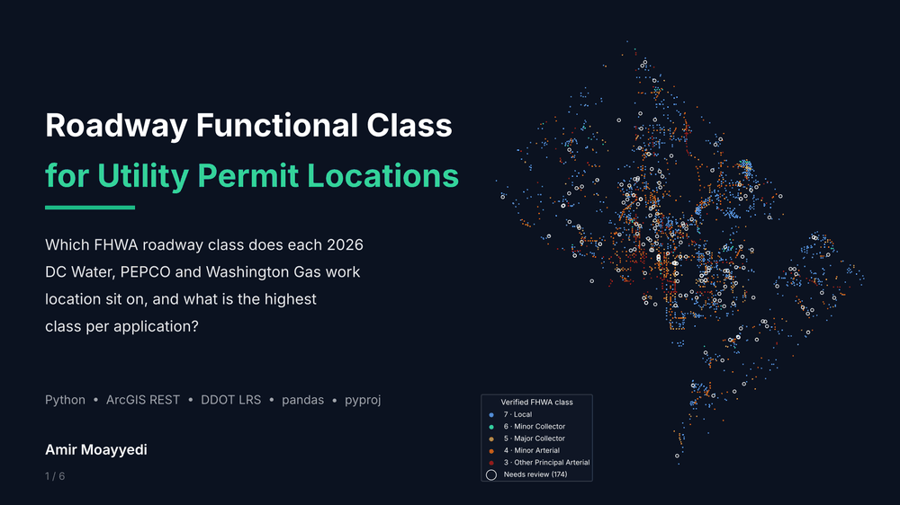
</p>

<table>
  <tr>
    <td><a href="assets/slides/slide_01.png">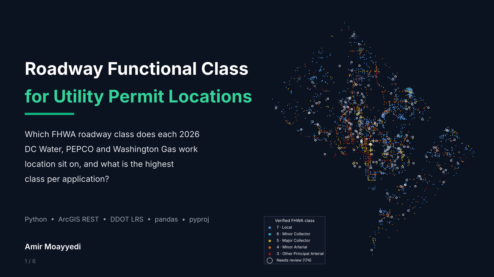</a></td>
    <td><a href="assets/slides/slide_02.png">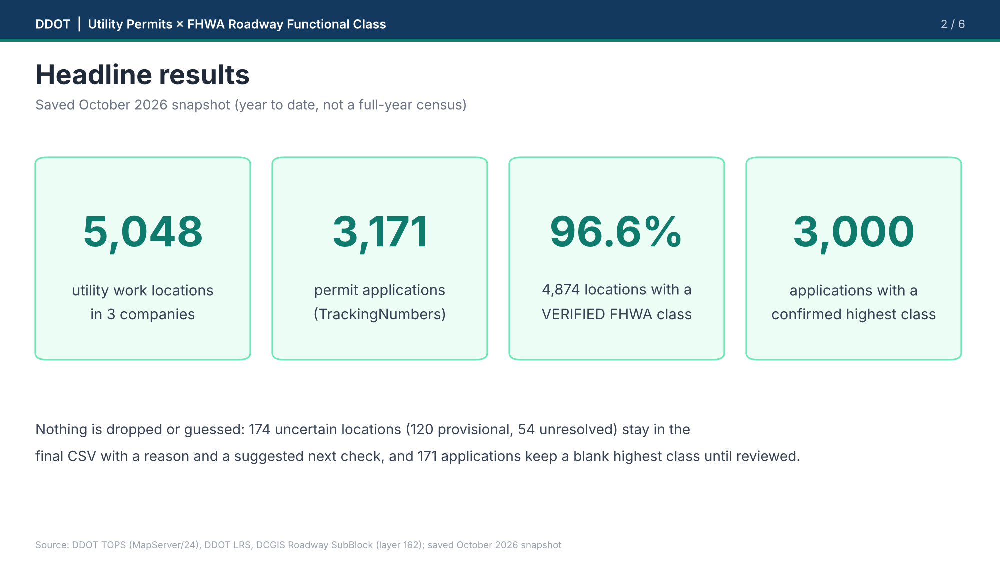</a></td>
    <td><a href="assets/slides/slide_03.png">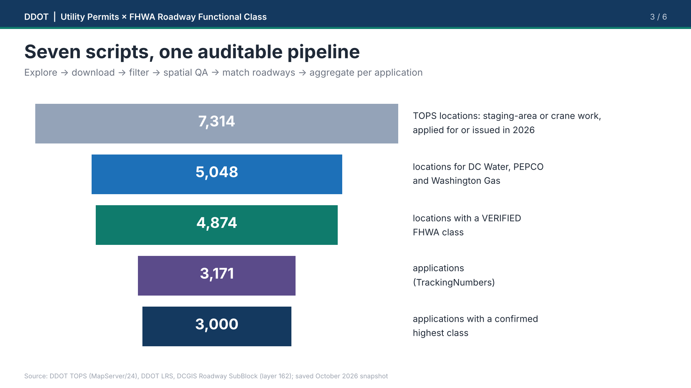</a></td>
  </tr>
  <tr>
    <td align="center"><sub>1 · Title</sub></td>
    <td align="center"><sub>2 · Headline results</sub></td>
    <td align="center"><sub>3 · Seven-script pipeline</sub></td>
  </tr>
  <tr>
    <td><a href="assets/slides/slide_04.png">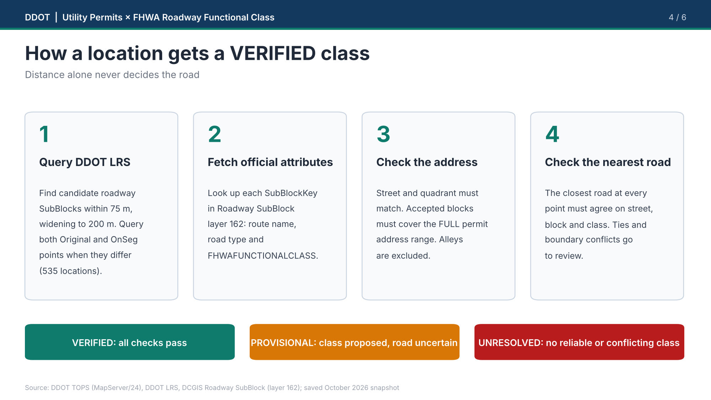</a></td>
    <td><a href="assets/slides/slide_05.png">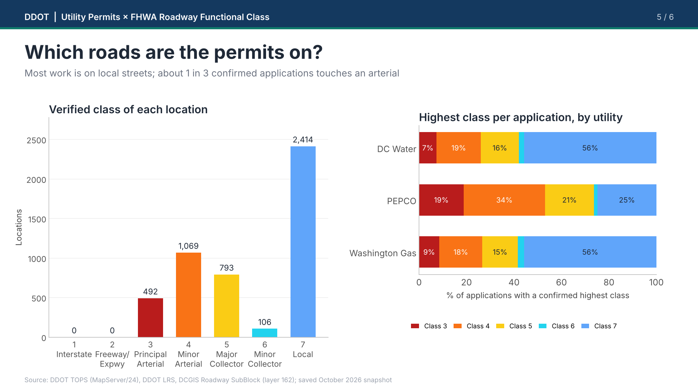</a></td>
    <td><a href="assets/slides/slide_06.png">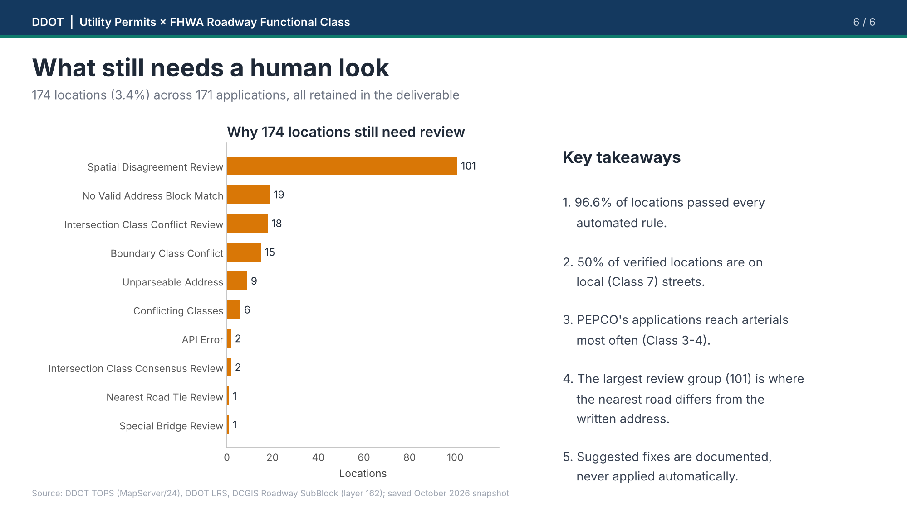</a></td>
  </tr>
  <tr>
    <td align="center"><sub>4 · How a class gets VERIFIED</sub></td>
    <td align="center"><sub>5 · Which roads the permits are on</sub></td>
    <td align="center"><sub>6 · What needs review & takeaways</sub></td>
  </tr>
</table>

<sub>Click any slide to open it at full size (2000 × 1125 px).</sub>

---

## 📑 Table of contents

1. [Key results](#-key-results)
2. [Key findings](#-key-findings)
3. [Results dashboard](#-results-dashboard)
4. [Pipeline overview](#️-pipeline-overview)
5. [Step-by-step methodology](#-step-by-step-methodology)
6. [Outputs and how to read them](#-outputs-and-how-to-read-them)
7. [Repository structure](#-repository-structure)
8. [Installation and how to run](#-installation-and-how-to-run)
9. [Validation](#-validation)
10. [Limitations](#️-limitations)
11. [Troubleshooting](#️-troubleshooting)

---

## 🎯 Key results

| Measure | Result |
|---|---:|
| TOPS locations: Construction Staging Area or Mobile Crane Work Zone, applied for **or** issued in 2026 | 7,314 |
| &nbsp;&nbsp;↳ Construction Staging Area / Mobile Crane Work Zone | 7,049 / 265 |
| **Utility locations** (DC Water 1,937 · PEPCO 1,397 · Washington Gas 1,714) | **5,048** |
| **Applications** (distinct `TrackingNumber`) | **3,171** |
| Locations with a **VERIFIED** class | **4,874 (96.6%)** |
| Locations with a PROVISIONAL / UNRESOLVED class | 120 / 54 |
| Applications with a **confirmed** highest class | **3,000** |
| Applications kept for review (16 partly verified + 155 with no verified location) | 171 |
| Roadway candidate evidence rows saved | 38,906 |

> **Snapshot:** the saved raw extract (`downloaded_utc` 2026-10-16 05:33 UTC) is a **year-to-date** snapshot, not a
> complete 2026 census. Re-running Step 02 against the live service will change the counts.
>
> **96.6% is a verification rate,** meaning the share of locations that passed every automated rule. It is **not** a
> spatial accuracy measured against independent ground truth.

---

## 💡 Key findings

| # | Finding | Evidence |
|---|---|---|
| 1 | **Most utility work is on local streets.** | 2,414 of 4,874 verified locations (49.5%) are Class 7 (Local) |
| 2 | **About 1 in 3 confirmed applications reaches an arterial.** | 953 of 3,000 have a highest class of 3 or 4 (31.8%) |
| 3 | **PEPCO's applications reach arterials most often.** | 53% of PEPCO's confirmed applications have Class 3–4, compared with 26% for DC Water and 27% for Washington Gas |
| 4 | **No location sits on an Interstate or freeway.** | Zero verified locations in Class 1 or 2 |
| 5 | **The biggest source of uncertainty is spatial disagreement.** | 101 of the 174 review locations: the nearest road differs from the written address |
| 6 | **Coordinates are consistent across reference systems.** | OnSeg vs ArcGIS geometry differ by at most 0.889 m under EPSG:26985 |

---

## 📊 Results dashboard

<p align="center">
  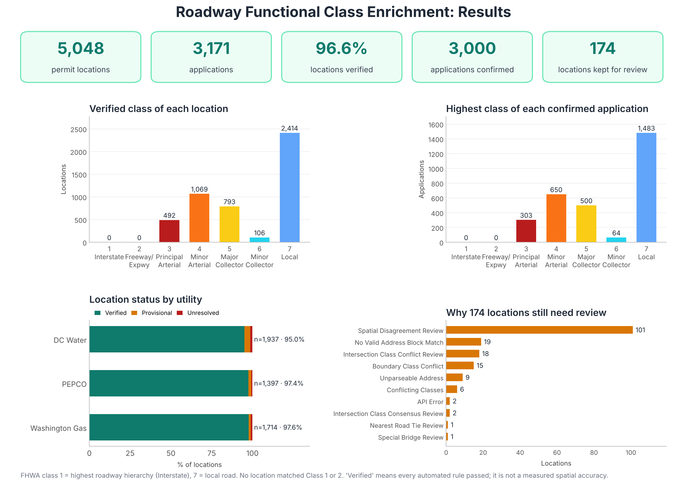
</p>

**FHWA functional classes used by DDOT**

| Code | Class | Verified locations | Confirmed applications (highest class) |
|:---:|---|---:|---:|
| 1 | Interstate | 0 | 0 |
| 2 | Other Freeways & Expressways | 0 | 0 |
| 3 | Other Principal Arterial | 492 | 303 |
| 4 | Minor Arterial | 1,069 | 650 |
| 5 | Major Collector | 793 | 500 |
| 6 | Minor Collector | 106 | 64 |
| 7 | Local | 2,414 | 1,483 |
| | **Total** | **4,874** | **3,000** |

> A **lower** code means a **higher** roadway hierarchy, so the "highest class" of an application is the **minimum** code
> across its locations.

---

## ⚙️ Pipeline overview

<p align="center">
  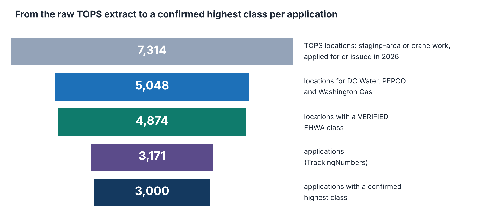
</p>

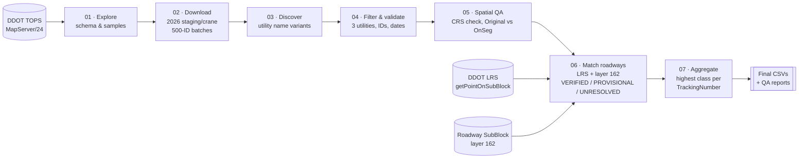

| Step | Script | Purpose | Main output |
|---|---|---|---|
| 01 | [`01_explore_data.py`](src/01_explore_data.py) | Read saved 10- and 500-record samples; list 112 fields, activity labels, company names | Console |
| 02 | [`02_download_permits.py`](src/02_download_permits.py) | Get all matching OBJECTIDs, download in 500-ID batches, verify each batch | `data/2_raw/` |
| 03 | [`03_identify_utility_companies.py`](src/03_identify_utility_companies.py) | Search ApplicantCompany, PermitteeName and OwnerName for utility name variants | Console |
| 04 | [`04_validate_and_filter_permits.py`](src/04_validate_and_filter_permits.py) | Map exact ApplicantCompany aliases; validate IDs, dates and activities | `data/3_processed/`, `outputs/1_validation/` |
| 05 | [`05_spatial_assessment_and_pilot.py`](src/05_spatial_assessment_and_pilot.py) | Check coordinates and the candidate CRS; compare Original and OnSeg; 30 m pilot road query | `outputs/2_spatial/` |
| 06 | [`06_match_roadways_and_assign_functional_class.py`](src/06_match_roadways_and_assign_functional_class.py) | Find LRS candidates, look up official attributes, apply address and nearest-road rules | `outputs/3_roadway_functional_class/` |
| 07 | [`07_calculate_highest_functional_class_per_permit.py`](src/07_calculate_highest_functional_class_per_permit.py) | Group by TrackingNumber, take the minimum verified class, join back to every location | `outputs/4_permit_highest_functional_class/` |

---

## 🔬 Step-by-step methodology

### Key identifiers

| Field | Meaning |
|---|---|
| `LocationID` | One permit work location; **one row** in the final CSV |
| `TrackingNumber` | One application; groups its locations in Step 07 (always present) |
| `PermitNumber` | Issued-permit identifier; **blank for 2,580** selected locations (not yet issued), so it is not used for grouping |
| `SubBlockKey` | A DDOT roadway segment ID, used to retrieve the official class. It is **not** a permit ID |

### Steps 01–02: discover and download
- With no data dictionary, Step 01 profiles a 10-record unfiltered sample (112 attributes) and a 500-record date-filtered
  sample to find the exact labels `Construction Staging Area` and `Mobile Crane Work Zone`.
- Step 02 selects either activity where `ApplicationDate` **or** `IssueDate` falls in
  `[2026-01-01, 2027-01-01)`. It first requests every OBJECTID, then downloads 500-ID batches, and stops if any batch
  returns IDs different from those requested.

### Steps 03–04: identify the utilities
Company names vary, so Step 03 searches all three name fields with regular expressions. Step 04 then selects locations by
**normalized exact** `ApplicantCompany` aliases. Normalization only changes case and repeated spaces.

| Utility | Normalized ApplicantCompany aliases | Locations |
|---|---|---:|
| DC Water | `dcwater/cip`, `dcwater/ops`, `dcwater` | 1,937 |
| PEPCO | `potomac electric power company`, `pepco` | 1,397 |
| Washington Gas | `wash gas & light co.` | 1,714 |

Matches in PermitteeName or OwnerName are **checked, not included**: none suggested a missed or conflicting utility.
No Mobile Crane Work Zone record belongs to the three utilities, so all 5,048 locations are Construction Staging Areas.
The script stops if it finds duplicate OBJECTIDs, missing LocationIDs, date or activity failures, or applications shared
across utilities.

### Step 05: spatial QA
| Check | Result |
|---|---|
| Locations with usable geometry and both coordinate pairs | 5,048 / 5,048 |
| Original (`XCoord/YCoord`) **identical** to OnSeg (`OnSegX/OnSegY`) | 4,513, so one point is queried |
| Original **differs** from OnSeg (no tolerance applied) | 535, so **both** points are queried |
| Largest Original-to-OnSeg separation | 99.88 m |
| Largest OnSeg-to-ArcGIS-geometry residual under candidate **EPSG:26985** | 0.889 m |
| `RoadwaySegID` / `StreetSegID` usable for a direct join | No (missing or zero everywhere) |

EPSG:26985 (NAD83 / Maryland) is a **working hypothesis** that the small residual supports. It has not been
certified by DDOT metadata. A 30 m pilot query on Roadway SubBlock layer 162 (9 locations, 29 candidates) showed that
nearby-road searches return several alternatives, which motivated the stricter Step 06 rules.

### Step 06: match roadways and confirm the class

<p align="center">
  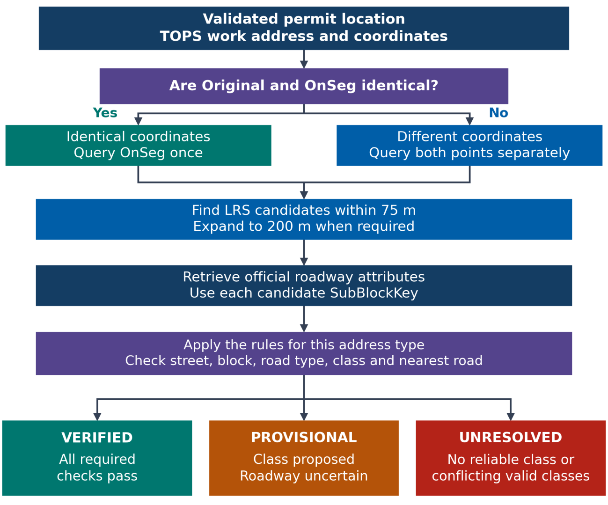
</p>

1. **Candidate discovery:** query the DDOT LRS `getPointOnSubBlock` service within **75 m**, widening to **200 m** when
   the 75 m results don't fully cover the address range with valid official evidence. These radii are search windows,
   **not** acceptance thresholds.
2. **Official attributes:** look up each candidate `SubBlockKey` in **Roadway SubBlock layer 162** to get the route name,
   road type and `FHWAFUNCTIONALCLASS`.
3. **Address rules:** the street and quadrant must match. `STREET`→`ST` and similar abbreviations are standardized, and NW, NE, SW
   and SE are kept as different streets. The road type must be a street, not an alley, with a class from 1 to 7. Accepted blocks must
   **together cover the full permit address range**: for a permit covering 2000–2099, support for only 2000–2049 is not enough.
4. **Nearest-road rule:** the closest LRS road at **every** queried point must agree on street, block and class.
   Equal-distance ties with a non-matching road, or neighbouring boundary blocks with a different class, go to review.
5. **Special cases:**
   - **Intersections** (`X STREET AND Y STREET`) are verified only when both named roads are the nearest candidates and share one class.
   - `EAST/NORTH/SOUTH CAPITOL ST BN` is treated as an alias for the plain route name.
   - Roosevelt Bridge is treated as I-66 but stays **provisional**.
   - Ramps and exits stay **unresolved**.

| Outcome | Meaning | Roadway key |
|---|---|---|
| ✅ **VERIFIED** | All checks pass | One unique key, or several keys that agree on one class (no unique key is invented) |
| 🟧 **PROVISIONAL** | A class is proposed but a required check failed | Candidate keys and the reason are kept |
| 🟥 **UNRESOLVED** | No reliable class, or valid candidates conflict | No class selected |

<table>
<tr>
<td width="50%">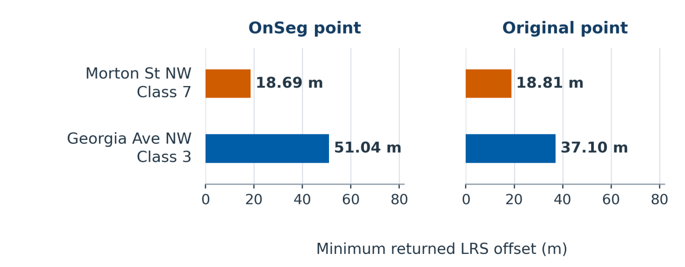</td>
<td width="50%">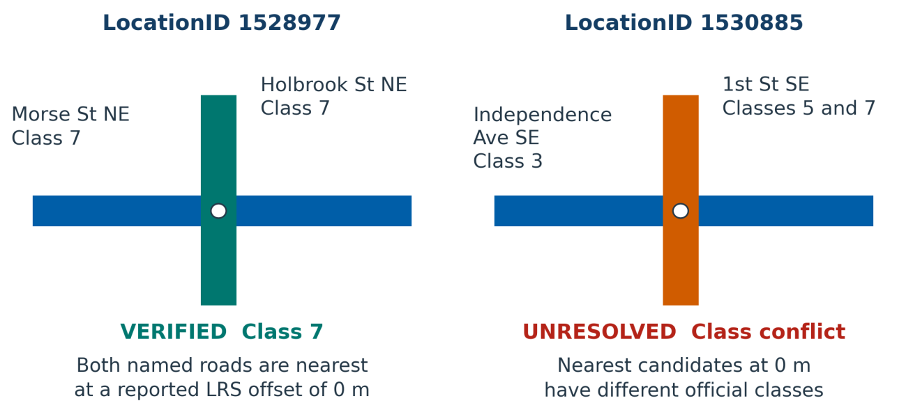</td>
</tr>
<tr>
<td><b>Distance and address can disagree.</b> LocationID 1510889 is written as <i>3333 Georgia Avenue NW</i> (Class 3), but Morton St NW (Class 7) is closer to both TOPS points. Class 3 is kept as <b>PROVISIONAL</b> and neither road is silently substituted.</td>
<td><b>Intersections need both roads.</b> Left (LocationID 1528977): both named roads are nearest and both are Class 7, so the location is <b>VERIFIED</b>. Right (LocationID 1530885): the nearest candidates have different classes, so it is <b>UNRESOLVED</b>. These diagrams are schematic, not maps.</td>
</tr>
</table>

Raw API replies are cached in SQLite and progress is checkpointed every 50 locations, so an interrupted run resumes
where it stopped. The cache stores **responses only**, never classification decisions.

### Step 07: highest class per application
- Group locations by `TrackingNumber` and take the **minimum** class code among VERIFIED locations.
- The application-level `HighestFHWAFunctionalClassPerPermit` is filled **only if every location is VERIFIED**.
  *Example:* application 11182457 has four verified locations with classes 7, 4, 4 and 4, so its highest class is **4**.
- If any location is unverified, the confirmed field stays **blank**. `HighestFHWAClassAmongVerifiedLocations` is shown for
  context only. *Example:* application 11213843 has one verified Class 7 location and one provisional Class 7 location, so its
  confirmed class is blank.
- The application result is merged back to every location (`many_to_one`). Assertions guarantee that no location is lost or
  duplicated and that no partly verified application receives a confirmed class. Step 07 makes **no API calls**.

| Application outcome | Applications |
|---|---:|
| All locations verified: highest class **confirmed** | 3,000 |
| Some locations verified: confirmed class withheld | 16 |
| No locations verified: confirmed class withheld | 155 |
| **Total** | **3,171** |

---

## 📂 Outputs and how to read them

### ⭐ Primary deliverables: `outputs/4_permit_highest_functional_class/01_primary_results/full/`

| File | Rows | Description |
|---|---:|---|
| `permit_locations_with_highest_fhwa_functional_class.csv` | 5,048 | **Main deliverable:** one row per location, with its own class and status plus the application-level result |
| `permit_tracking_highest_fhwa_functional_class_summary.csv` | 3,171 | One row per application, with location counts and the confirmed or pending highest class |

**Key columns in the main CSV**

| Column(s) | How to read it |
|---|---|
| `LocationID`, `TrackingNumber`, `PermitNumber` | Location, its application and the issued permit (if any) |
| `UtilityCompany`, `WorkLocationFullAddress` | Utility and written work address |
| `LocationFHWAFunctionalClass` + `LocationClassStatus` | Always read **together**: a class is only confirmed when the status is `VERIFIED` |
| `LocationMatchStatus`, `Explanation` | Which matching rule passed or failed |
| `SelectedSubBlockKey`, `MatchedSubBlockKeys`, `SubBlockKeyStatus` | The unique confirmed roadway key when justified, otherwise all accepted or candidate keys |
| `HighestFHWAFunctionalClassPerPermit` | Confirmed highest class of the **whole application** (blank if any location is unverified) |
| `HighestFHWAClassAmongVerifiedLocations` | Context only; not confirmed for the whole application |
| `HighestClassDeterminationStatus`, `PermitNeedsClassReview` | `CONFIRMED_ALL_LOCATIONS_VERIFIED`, `REVIEW_PARTIAL_VERIFIED_LOCATIONS` or `REVIEW_NO_VERIFIED_LOCATIONS` |
| `SuggestedNextAction_NotApplied` | A recommended manual check, **documented but not applied** |

### Quality control and limitations: `outputs/4_permit_highest_functional_class/02_quality_control_and_limitations/full/`

| File | Description |
|---|---|
| `permit_tracking_numbers_needing_highest_class_review.csv` | The 171 applications without a confirmed highest class |
| `permit_locations_needing_fhwa_class_review_with_tracking_context.csv` | The 174 unverified locations with reasons and suggested checks |
| `permit_unverified_location_reason_summary.csv` | Counts by reason and status |
| `permit_highest_class_quality_summary.csv` | Cross-step reconciliation counts |

### Why 174 locations need review

| `LocationMatchStatus` | Status | Locations | What is uncertain |
|---|---|---:|---|
| `SPATIAL_DISAGREEMENT_REVIEW` | Provisional | 101 | The nearest road differs from the written address |
| `NO_VALID_ADDRESS_BLOCK_MATCH` | Unresolved | 19 | No official candidate passes the street and block checks |
| `INTERSECTION_CLASS_CONFLICT_REVIEW` | Unresolved | 18 | The two named roads have different classes |
| `BOUNDARY_CLASS_CONFLICT` | Provisional | 15 | A partial or boundary block nearby has another class |
| `UNPARSEABLE_ADDRESS` | Unresolved | 9 | Ramp, exit or unsupported address format |
| `CONFLICTING_CLASSES` | Unresolved | 6 | Accepted candidates disagree on class |
| `API_ERROR` | Unresolved | 2 | Roadway-attribute query failed (HTTP 503) and needs a retry |
| `INTERSECTION_CLASS_CONSENSUS_REVIEW` | Provisional | 2 | Same class, but the intersection geometry is ambiguous |
| `NEAREST_ROAD_TIE_REVIEW` | Provisional | 1 | An equally near incompatible candidate |
| `SPECIAL_BRIDGE_REVIEW` | Provisional | 1 | The bridge alias doesn't identify the exact segment |
| **Total** | | **174** | All retained in the final CSV |

<details>
<summary><b>Intermediate outputs (Steps 04–06)</b></summary>

| Folder | Files |
|---|---|
| `outputs/1_validation/` | `applicant_company_name_inventory.csv` (every observed company name), `permit_filter_validation_summary.csv`. Review CSVs are only written when a check finds issues, and none did |
| `outputs/2_spatial/` | `spatial_data_quality_summary.csv`, `all_permit_records_original_onseg_arcgis_comparison.csv`, `records_with_different_original_onseg_coordinates.csv`, `pilot_nearby_roadway_candidates.csv` |
| `outputs/3_roadway_functional_class/{pilot,full}/` | `permit_locations_fhwa_functional_class.csv`, `permit_locations_lrs_roadway_candidate_evidence.csv`, `permit_locations_functional_class_needing_review.csv`, `permit_locations_api_errors.csv`, `roadway_matching_status_summary.csv` |
| `outputs/3_roadway_functional_class/` | `ddot_lrs_raw_api_cache.sqlite3`: raw API response cache (about 100 MB) |

The 18-location Step 06 pilot (14 verified, 3 provisional, 1 unresolved) agrees with the corresponding full-run rows.
</details>

---

## 📁 Repository structure

```text
Python_DDOT/
├── README.md
├── requirements.txt
├── src/                                    # 7 pipeline scripts, run in order
│   ├── 01_explore_data.py
│   ├── 02_download_permits.py
│   ├── 03_identify_utility_companies.py
│   ├── 04_validate_and_filter_permits.py
│   ├── 05_spatial_assessment_and_pilot.py
│   ├── 06_match_roadways_and_assign_functional_class.py
│   └── 07_calculate_highest_functional_class_per_permit.py
├── data/
│   ├── 1_samples/      # 10-record schema sample, 500-record exploration sample
│   ├── 2_raw/          # all 7,314 date/activity locations (JSON, with geometry)
│   └── 3_processed/    # 5,048 three-utility locations (JSON, + UtilityCompany)
├── outputs/
│   ├── 1_validation/
│   ├── 2_spatial/
│   ├── 3_roadway_functional_class/          # pilot/, full/, SQLite raw-response cache
│   └── 4_permit_highest_functional_class/
│       ├── 01_primary_results/full/         # ⭐ final deliverables
│       └── 02_quality_control_and_limitations/full/
├── docx/
│   ├── DDOT_Python_test_report.pdf          # technical report
│   └── DDOT_Python_test_report.docx
└── assets/                                  # README images
    ├── permit_map.png · pipeline_funnel.png · results_dashboard.png
    ├── slides/ · slides_preview.gif
    ├── report/                              # figures from the technical report
    └── make_readme_figures.py               # regenerates the README images (no API calls)
```

---

## 🚀 Installation and how to run

**Requirements:** Python 3.11 (recommended) and internet access to the DCGIS and DDOT ArcGIS services for fresh queries.

<details open>
<summary><b>Windows (PowerShell)</b></summary>

```powershell
py -3.11 -m venv .venv
.\.venv\Scripts\Activate.ps1
python -m pip install --upgrade pip
python -m pip install -r requirements.txt
```
</details>

<details>
<summary><b>macOS / Linux</b></summary>

```bash
python3 -m venv .venv
source .venv/bin/activate
python -m pip install --upgrade pip
python -m pip install -r requirements.txt
```
</details>

Run from the **repository root**, in order:

```bash
python src/01_explore_data.py                  # reads data/1_samples (no download)
python src/02_download_permits.py              # ⚠️ live download; overwrites data/2_raw
python src/03_identify_utility_companies.py    # console exploration only
python src/04_validate_and_filter_permits.py
python src/05_spatial_assessment_and_pilot.py
python src/06_match_roadways_and_assign_functional_class.py
python src/07_calculate_highest_functional_class_per_permit.py
```

**Pilot or full run:** Steps 06 and 07 share a `RUN_MODE` switch at the top of each script:

```python
RUN_MODE = 'pilot'   # 18 locations: 3 per (utility × identical/different coordinates)
RUN_MODE = 'full'    # all 5,048 locations (current setting)
```

Use the **same** mode in both scripts. The pilot is a deterministic functional check, **not** a representative accuracy sample.

> **To reproduce the saved results without new downloads,** skip Step 02. Step 06 resumes from its saved CSV checkpoint
> and reuses the SQLite cache of raw responses.
>
> **Checkpoint warning:** Step 06 skips `LocationID`s already in that mode's result CSV. If you change the matching
> rules or the input data, rename or back up `outputs/3_roadway_functional_class/<mode>/` first, otherwise old
> decisions are reused. The raw-response cache can usually be kept.

The scripts also contain `# %%` cell markers for the VS Code Python Interactive window, which uses `ipykernel` from `requirements.txt`.

**Regenerate the README images** (optional; reads only the saved outputs):

```bash
pip install matplotlib pillow
python assets/make_readme_figures.py
```

---

## ✅ Validation

**Built into the pipeline**
- Download completeness: the OBJECTID list matches, and every 500-ID batch is checked.
- No duplicate OBJECTIDs or LocationIDs, and no missing LocationIDs or TrackingNumbers.
- Date and activity criteria re-checked (0 failures), and no application is shared across utilities.
- Secondary name fields are checked for missed or conflicting utilities (0 found).
- Coordinate availability is checked and the candidate CRS is tested for consistency.
- Every VERIFIED class must have supporting official candidate evidence (the script stops otherwise).
- Step 07 reconciles location and application counts and enforces the "confirmed only when all locations are verified" rule.

**Not implemented (possible extensions)**
- An independent GIS or manual ground-truth audit.
- A Master Address Repository (MAR) cross-check.
- Official confirmation of the TOPS Original/OnSeg CRS.
- An automated `tests/` suite (`pytest` is listed in the requirements, but no tests ship yet).
- Tolerance-based (`math.isclose`) nearest-road tie detection; ties currently use exact equality.

---

## ⚠️ Limitations

- **Snapshot:** results describe the saved year-to-date extract, not all of 2026.
- **Verification is not accuracy:** 96.6% is the share of locations that pass the rules, not a measured match accuracy.
- **Conservative by design:** the 174 uncertain locations are **retained**, never dropped or filled with the nearest class.
  Suggested follow-ups are documented, **not applied**.
- **Project choices, not DDOT standards:** the 75/200 m search radii, the 1,000-number suspicious-range flag and the
  EPSG:26985 interpretation.
- **Pilot scope:** a pilot may include only some locations of an application, so pilot confirmations apply only within the sample.
- **External services:** availability and content of the public DDOT and DCGIS services are outside this project's control.
- **Dependency ranges:** `requirements.txt` lists compatible ranges, not a frozen environment. Use `pip freeze` to archive exact versions.

---

## 🛠️ Troubleshooting

| Symptom | Fix |
|---|---|
| `FileNotFoundError` | Run from the repo root; make sure the upstream JSON or CSV files exist |
| `ModuleNotFoundError` | Activate `.venv` and run `pip install -r requirements.txt` |
| ArcGIS / DDOT API error | Check network access and retry; Step 06 resumes from its checkpoint |
| Step 06 finishes instantly | Checkpoint behaviour: rename the mode's output folder for a clean recomputation |
| `PermissionError` writing a CSV | Close the file in Excel, then rerun |
| Step 07 says Step 06 results are missing | Run Step 06 with the same `RUN_MODE` first |

---

<div align="center">

**Amir Moayyedi**
Data: District Department of Transportation (DDOT) and DC GIS open data ·
Full technical report: [`docx/DDOT_Python_test_report.pdf`](docx/DDOT_Python_test_report.pdf)

</div>
